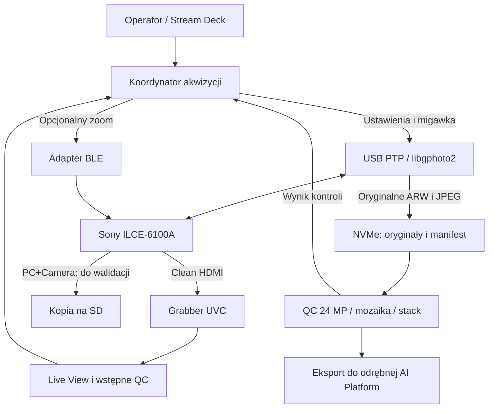

# Vision — audyt protokołów Sony ILCE-6100A i rekomendacja akwizycji

**Data:** 2026-10-13. **Status:** AUDIT / RECOMMENDATION PROPOSED — wymaga decyzji właściciela; bez wdrożenia i bez merge.
**Repo bazowe:** `autoklinika/Vision`, `main` = `22cc025dffaea85260b7356494c86984be375ecc`.
**Zakres:** Sony ILCE-6100A ↔ Arduino VENTUNO Q, Ubuntu 24.04.4 ARM64, kernel `6.8.0-1084-qcom`. Nie zmieniono innych projektów.

## 1. Rekomendacja

**Preferowany wariant B+: clean HDMI do szybkiego podglądu, USB PC Remote/PTP przez libgphoto2 do ustawień, wyzwalania i natychmiastowego odbioru oryginalnych ARW/JPEG na NVMe, opcjonalne BLE do Power Zoom.**

Dla automatyki PCB ważna jest kontrola pełnego zdjęcia po każdym ujęciu. Ten wariant nie wymaga przechodzenia z fotografowania przez Wi-Fi do importu Mass Storage ani ręcznego wznawiania Wi-Fi. Oddziela podgląd od akwizycji oryginałów. Zoom podczas skalibrowanej serii powinien być stały; BLE jest potrzebne do ustawienia kadru i obsługi operatora, nie do zmiany powiększenia między ujęciami mozaiki.

To **jednoznaczny wybór preferowanego kierunku**, nie potwierdzenie gotowości produkcyjnej. Potwierdzono USB fotografie przy podłączonym monitorze HDMI i BLE; osobno uzyskano HDMI/UVC 1080p30. **Nie wykonano jeszcze wspólnego testu ciągłego UVC + trwałej sesji PTP + serii RAW+JPEG + BLE**, pomiaru jakości na PCB ani wielogodzinnej próby. Bramki opisano w sekcji 11.

Dla najwyższej jakości szybkiego cyfrowego podglądu preferować docelowo grabber **USB 3 z faktycznym nieskompresowanym 1080p30/60**. Obecny MacroSilicon pozwala rozpocząć walidację w MJPEG 1080p30; nie ma dowodu, że już spełnia wymaganie najwyższej jakości. Zakup zależy od porównania optycznego. Bezpośrednie HDMI na monitor jest dobrym torem operatora, lecz samo nie dostarcza obrazu do OpenCV.

Wariant D, czyli HDMI + Wi-Fi → SD → okresowy USB Mass Storage, pozostaje alternatywą do sesji z opóźnioną kontrolą jakości lub funkcji dostępnych wyłącznie przez Wi-Fi. **Nie jest preferowany do w pełni automatycznego stanowiska**, ponieważ powrót do Wi-Fi nie był bezobsługowy, a oryginały trafiają na NVMe dopiero po imporcie. Poprzedni ADR był PROPOSED; ten audyt proponuje inny priorytet i go nie nadpisuje.

## 2. Podstawa dowodowa i bieżąca dostępność

Rozróżnienie statusów:

- **PASS** — wykonana próba sprzętowa; obok podano, czy dowodem jest plik/pomiar, odczyt stanu czy obserwacja operatora.
- **SUPPORTED** — potwierdzenie dokumentacją właściwego modelu lub jego deklaracją możliwości, bez funkcjonalnego testu danej czynności.
- **UNSUPPORTED** — potwierdzony brak w konkretnym interfejsie/trybie; nie rozciągać na cały aparat.
- **UNKNOWN** — niedostateczny dowód. Dawne NOT TESTED / UNVERIFIED odpowiadają UNKNOWN.

Źródła zebrano z `main`, dwóch nowszych gałęzi dokumentacyjnych i lokalnych raportów oraz plików NVMe. Starsze raporty zawierają nierozstrzygnięte punkty, które późniejsze próby domykają tylko w swoim zakresie. Nie uznano daty dokumentu ani samego napisu PASS za wystarczający dowód.

**Stan w tym audycie, 19:13 UTC:** NVMe rzeczywiście zamontowany, ext4 rw, etykieta VISION_DATA; grabber `534d:2109` obecny, Sony `054c:0f0d/0f0b` nieobecny; dedykowany Wi-Fi Sony rozłączony. Nie ustanawiano nowej sieci, nie zmieniano ustawień aparatu, usług, sterowników ani firmware. Nie wykonywano zdjęć i komend napędu.

Nowe bezpieczne kontrole:

| Kontrola | Wynik | Granica |
| --- | --- | --- |
| NVMe mountpoint, urządzenie NVMe, ext4, label, rw przed zapisem | PASS | Nie jest to ponowny audyt całego NVMe Write Guard |
| SHA-256 czterech zachowanych ARW/JPEG | 4/4 zgodne z dawnym rekordem tych samych plików | Karta Sony niepodłączona; nie wykonano nowego SD↔NVMe porównania |
| JPEG oryginalne RAW-02 i DSC00020 | 2/2 pełne dekodowanie 6000×4000 | Nie jest to test jakości względem identycznej sceny |
| STAB-05, zachowane fotografie | 10/10 dekoduje się jako 6000×4000 | Nie wykonano nowej serii |
| LV-05, zachowane klatki | 85/85 dekoduje się jako 1024×680 | Nie zmierzono ponownie FPS ani latencji |
| EXIF zdjęć przed/po BLE TELE przy HDMI i USB | 16,0 → 20,0 mm | Telemetria po zdjęciu, nie odczyt zoomu na żywo |
| Aktualne deskryptory V4L2 | MJPEG 1080p do deklarowanych 60; YUYV 1080p5 | Lista formatów nie dowodzi faktycznych FPS ani jakości sceny |

Pełny nowy zapis kontroli: `/srv/vision-data/vision/sessions/sony-protocol-audit-20261013T191340Z/offline-evidence-recheck.json`; deskryptory: `uvc-advertised-formats.txt` w tym samym katalogu. Publiczny, ograniczony zapis dowodów: [SONY_PROTOCOL_AUDIT_EVIDENCE_2026-10-13.json](SONY_PROTOCOL_AUDIT_EVIDENCE_2026-10-13.json).

## 3. Protokoły i macierz możliwości

| Kanał | Podgląd | Wyzwalanie/ustawienia | Oryginał na NVMe | Najważniejsza granica |
| --- | --- | --- | --- | --- |
| USB PC Remote/PTP, Sony extensions | PASS JPEG 1024×680 | Migawka i część ustawień PASS | PASS JPEG 24 MP oraz ARW | Szybkie powtórki miały błędy; wymagana serializacja i gotowość |
| USB Mass Storage | UNSUPPORTED jako Live View | UNSUPPORTED jako kanał komend aparatu | PASS JPG/ARW z SD, kopia bitowa | Osobny tryb USB; nie traktować jako współbieżnego kanału fotografowania |
| Wi-Fi ScalarWebAPI, Remote | PASS JPEG 640×424; postview 1616×1080 | PASS migawka, ekspozycja/WB i zoom w zakresie prób | UNSUPPORTED w badanej sesji dla ARW i pełnego JPEG | Oryginały zapisywane na SD; nie było avContent ani URI oryginałów |
| Wi-Fi Send to Smartphone | Nie oceniano jako Live View | Osobny tryb importu | SUPPORTED JPEG „Original”; ARW UNSUPPORTED w tej funkcji | Sony dokumentuje konwersję RAW→JPEG; Linux automatyzacja UNKNOWN |
| HDMI → MacroSilicon UVC | PASS 1920×1080 MJPEG około 30 w krótkiej sesji po rozruchu | UNSUPPORTED jako transport komend fotograficznych | UNSUPPORTED jako transfer ARW/JPEG z aparatu | Klatka wideo nie jest oryginalną fotografią |
| HDMI → monitor bez grabbera | PASS clean view obserwowany przez operatora | Nie realizuje sterowania | Nie realizuje importu | Omija kompresję grabbera, ale nie dostarcza klatek VENTUNO |
| BLE remote | UNSUPPORTED jako kanał obrazu/plików w badanym protokole pilota | PASS zoom; inne funkcje zależą od testu | UNSUPPORTED jako import w tym protokole | Przyjęcie write nie dowodzi ruchu; brak potwierdzonej pozycji zoomu w mm |
| Multi/Micro USB, dodatkowe styki pilota | UNKNOWN w tym stanowisku | Potencjalny kanał akcesoriów | Nie udowodniono transportu zdjęć dodatkowymi stykami | Wymaga właściwego akcesorium; nie uzasadnia budowy nowego toru teraz |

### 3.1 USB/PTP i implementacje Linux

Wcześniej używano `gphoto2 2.5.28` i `libgphoto2 2.5.31`; gPhoto2 znajduje się w izolowanym katalogu `/srv/vision-data/tools/sony-a6100-verify/root/usr/bin/`. Brak w PATH nie oznacza braku narzędzia. Prawa udev umożliwiały pracę bez sudo.

Aparat zgłosił Sony PTP Extensions i rozszerzenie PTP 2.00, 45 właściwości, 18 komend; odczyt zbiorczy zawierał 62 deskryptory, brakujący względem listy był D220. To dowód zakresu deklaracji, nie wykonania każdej funkcji. **PTP 3 niezweryfikowany.**

Właściwość D214 jest w referencji Sony Predicted Maximum File Size, a nie Zoom. Surowy odczyt: UINT32, 34497536, tylko GET. W aktualnym upstream libgphoto2 nadal istnieje heurystyczny wpis Sony_Zoom pod tym kodem. Nie używać widgetu `zoom=34.4975` do ustawiania ani odczytu ogniskowej. Sama aktualizacja biblioteki nie daje dowodu rozwiązania tego problemu. [G1, G2, P3]

Rekomendowana podstawa implementacji to libgphoto2 z jednym właścicielem sesji PTP. gPhoto2 CLI pozostaje narzędziem diagnostycznym. Nie otwierać równolegle sesji przez CLI, własne libusb i bibliotekę produkcyjną.

Sony **Camera Remote Command** obejmuje ILCE-6100A; **Camera Remote SDK** nie wymienia go na aktualnej liście urządzeń, choć obsługuje Linux ARM64. Nie instalować SDK w nadziei na funkcje tego modelu. Sony informuje o zmianach dostępności PTP 2 od 2027 dla części modeli; nie stanowi to dowodu, że ten egzemplarz przestanie działać. Wymaga śledzenia konkretnej kompatybilności. [S1, S2]

Przegląd innych implementacji:

| Projekt | Co wnosi | Ocena dla Vision |
| --- | --- | --- |
| libgphoto2 | API C, istniejące działające PTP i pobieranie zdjęć | Preferowana baza; wymagane ograniczenia modelu i walidacja wyniku |
| Sony Camera Remote Command, przykłady Linux/libusb | Oficjalna referencja protokołu, porównanie mapowania komend | Punkt odniesienia; własny adapter dopiero przy udowodnionej luce |
| olkham/pysonycam | Alternatywny klient PTP, odczyty i sterowanie | README: test RX100 VII/Windows/PTP3; PTP2 tylko parser, bez testu sprzętowego. Nie dowodzi przewagi na A6100A |
| Bloodevil/sony_camera_api, petabite/libsonyapi | Klienci Wi-Fi ScalarWebAPI | Ułatwiają obsługę istniejących metod; nie dodają RAW/original API do aparatu |
| micolous/gst-plugins-sonyalpha | Demultipleksowanie JPEG Live View Wi-Fi w GStreamer | Testowany przez autora na A6000; protokół przydatny, zgodność A6100A wymaga próby |
| coral/freemote, Staacks/alpharemote | Opis pilota BLE, zoom/focus/shutter | Referencja BLE; lokalny dowód zoomu jest silniejszy niż ogólna lista modeli |

Nie uruchamiano instalatorów tych projektów. Uniwersalne przykłady zmieniające prawa na 0666 lub ponownie wyzwalające migawkę nie są wzorcem wdrożenia Vision. Nie stwierdzono biblioteki, która z dowodem sprzętowym dawałaby lepszy Live View lub nowe komendy PTP na naszym aparacie. [G3–G7]

### 3.2 Sterowanie — statusy dla konkretnego modelu

PASS odczytu/zapisu parametru nie jest dowodem optycznego efektu ani jego powtarzalności.

| Funkcja | USB PTP | Wi-Fi Remote | BLE | Dowód / ograniczenie |
| --- | --- | --- | --- | --- |
| Migawka | PASS | PASS | SUPPORTED w opisanym protokole, lokalny test dedykowany UNKNOWN | USB pełne zdjęcia; Wi-Fi half-press→take→cancel, zwykłe take raz 40400 |
| RAW/JPEG/RAW+JPEG | PASS zmiany i para RAW-02 | UNKNOWN zdalnego settera; PASS zapis RAW+JPEG na SD z ustawień aparatu | UNKNOWN | Wi-Fi postview nie potwierdza formatu źródła |
| ISO | SUPPORTED: właściwość/obsługa drivera, setter na tym modelu niezweryfikowany w odczytanych raportach | PASS AUTO→100→AUTO | UNKNOWN | Nie przenosić PASS Wi-Fi na PTP |
| Czas | SUPPORTED: właściwość i driver | PASS 1/250→1/320→1/250 | UNKNOWN | Zależne od trybu ekspozycji |
| Przysłona | SUPPORTED: właściwość i driver | PASS f/5,6→f/6,3→f/5,6 | UNKNOWN | Pierwszy Wi-Fi timeout, późniejsza próba i restore PASS |
| Balans bieli | SUPPORTED: właściwość i driver | PASS AUTO→Daylight→AUTO | UNKNOWN | Stały WB wymagany do porównania |
| AF / half-press | PASS fotografie w AF-A, SUPPORTED S1 | PASS sekwencja half-press | SUPPORTED funkcje pilota | Dokładność AF na PCB UNKNOWN |
| Wybór MF | PASS AF-A↔MF | UNKNOWN | UNKNOWN | To wybór trybu, nie ruch soczewek |
| Near/Far, krok ostrości | PASS przyjęcia komendy; UNKNOWN optycznej zmiany | UNKNOWN | SUPPORTED opis focus in/out, UNKNOWN na tym egzemplarzu | Nie nadawać PASS focus stackingowi |
| Focus bracketing / absolutna pozycja | UNKNOWN kontrolowanej automatyzacji | UNKNOWN | UNKNOWN | Brak dowodu kroku w mm/µm i powtarzalnej serii |
| Power Zoom | UNSUPPORTED w odczytanym, reklamowanym zestawie PTP2 | PASS komenda + zmiana pozycji API; mm/powtarzalność UNKNOWN | PASS optycznie EXIF 16→20 mm | Nie dotyczy wszystkich hipotetycznych protokołów Sony |
| Zoom/powiększenie podglądu | SUPPORTED Focus Magnifier i cancel w zestawie PTP2 | UNKNOWN | UNKNOWN | Powiększenie obrazu nie jest zoomem optycznym ani nowymi detalami |
| Punkt AF | SUPPORTED wybór obszaru D22C; UNKNOWN ustawiania współrzędnych | UNKNOWN | UNKNOWN | Nie uznawać ogólnych funkcji innych modeli za obsługę A6100A |
| Stan aparatu | PASS odczyty PTP | PASS getEvent / getterów | SUPPORTED notify AF/shutter/rec | BLE notify nie jest dowodem zapisania ARW na karcie |
| Koniec zapisu na SD | UNKNOWN jednoznacznego potwierdzenia w adapterze | UNKNOWN trwałego zapisu całej pary na podstawie ACK | UNKNOWN | IDLE i return API nie zastępują walidacji plików |
| Dostępność pliku | PASS odebrane obiekty zdjęć | PASS URI postview, UNSUPPORTED oryginalne URI w sesji | UNSUPPORTED w protokole pilota | W PC Remote ogólne list-files bywało puste |

Reklamowane komendy PTP2: D2C1 S1, D2C2 S2, D2C3 AEL, D2C9 FEL, D2C8 movie, D2D9 AWBL, D2C5 release lock, D2C7 request shooting, D2CB magnifier, D2CC cancel, D2CD–D2D0 remote arrows, D2D2 AF/MF hold, D2D3/D2D4 pixel-shift-related identifiers, D2D1 Near/Far. **Obecność identyfikatorów pixel shift nie dowodzi funkcji fotograficznej pixel shift w A6100A.** [P3]

## 4. Live View: rozdzielczość, kompresja, szczegóły

| Tor | Rzeczywiście otrzymany obraz | Kompresja | Wniosek jakościowy |
| --- | --- | --- | --- |
| Wi-Fi Live View | 640×424 = 0,271 MP | JPEG z aparatu | Najmniej próbek z przetestowanych torów; słaby kandydat na drobne SMD |
| USB Preview | 1024×680 = 0,696 MP | JPEG z aparatu | Lepsza liczba próbek; ciągle daleko od zdjęcia 24 MP |
| Wi-Fi postview | 1616×1080 = 1,745 MP | JPEG po zdjęciu | Nie jest szybkim ciągłym Live View ani oryginałem |
| HDMI/UVC | 1920×1080 = 2,074 MP ramki | Obecnie MJPEG w grabberze | Najsilniejszy kandydat na szybki podgląd; szczegóły i aktywny obszar wymagają testu |
| JPEG oryginał | 6000×4000 = 24 MP | JPEG utworzony w aparacie | Dokładna kontrola kadru/ostrości po zdjęciu |
| ARW oryginał | Dane sensora w źródłowym ARW | Compressed RAW aparatu | Źródło do opracowania; zachować bajty pliku |

HDMI jest sygnałem wideo; **nie przenosi plików JPEG/ARW** i nie wynika z tego dodatkowa kompresja zapisanych zdjęć. MJPEG dodaje stratne kodowanie podglądu w grabberze. Nie wykazano, że HDMI wejściowe powstaje z już skompresowanego JPEG; nie nazywać tego bez dowodu „podwójną kompresją”. Dekodowanie do wyświetlenia nie musi wprowadzać nowego kodowania JPEG; trzeba go unikać w aplikacji.

YUYV eliminuje kompresję MJPEG na łączu UVC, lecz **nie gwarantuje** braku wcześniejszego skalowania lub kompresji wewnątrz grabbera. Format YUYV 4:2:2 i 8-bitowy podgląd nie odpowiadają danym RAW sensora. Trzeba również zmierzyć zakres limited/full, macierz kolorów i zachowanie monitorowania kolorów.

Obecny grabber działa jako USB High-Speed 480 Mb/s. Czyste 1920×1080 YUYV30 wymaga **124 416 000 B/s = 995,328 Mb/s przed narzutem USB**. To obliczenie przepustowości, nie pomiar. Nie da się uzyskać tego nieskompresowanego strumienia przez USB2 samą zmianą aplikacji. Deskryptory podają 1080p YUYV5, a MJPEG 1080p30 było testowane. Deklarowane 60 FPS nie jest potwierdzone unikalnymi klatkami.

Aparat dokumentuje HDMI 2160p/1080p, ale oddzielne **4K Output Select jest funkcją trybu movie**. Nie potwierdzono 4K podczas wymaganej akwizycji fotografii RAW ani bez przełączania trybu. W dodatku MacroSilicon nie reklamuje 4K jako wyjścia UVC. Zakup grabbera „4K input” nie dowodzi 4K capture ani działania 4K w naszym cyklu. [S3, S4]

Stosunek proporcji ma znaczenie: zdjęcie 3:2 i ramka HDMI 16:9 mogą różnić się kadrowaniem lub mieć pasy. Pełna ramka 1920×1080 nie oznacza, że każdy piksel przedstawia PCB. Skalowanie do wyjścia UVC może ukrywać niższą efektywną rozdzielczość. Rzeczywista rozdzielczość odczytu sensora, crop, sampling i rozdzielczość aktywnej sceny HDMI pozostają UNKNOWN.

**Maksimum przetestowane ≠ maksimum możliwe:** obecnie dowód cyfrowy obejmuje 1080p MJPEG30; 4K i nieskompresowane szybkie HDMI są kandydatami do sprawdzenia. Nie udowodniono jeszcze ilościowej przewagi w odczycie oznaczeń PCB.

### 4.1 Powtarzalne porównanie jakości i latencji

Po uzgodnieniu testu operator ustawia nieruchomą PCB z drobnymi napisami, ścieżkami i wzorcem ukośnej krawędzi, aparat na stabilnym mocowaniu. Stałe: ogniskowa, odległość, MF, M, ISO, przysłona, czas, WB i oświetlenie. Wyłączyć zoom cyfrowy; zapisać wszystkie nastawy. Jeśli zmiana trybu automatycznie zmienia crop/ekspozycję, zarejestrować to i porównać wspólny obszar zamiast deklarować identyczną geometrię.

Próbki: USB JPEG Preview, Wi-Fi Live View, HDMI MJPEG1080p30, HDMI YUYV1080p5, opcjonalnie grabber USB3 YUYV/NV12, oraz pełny JPEG/ARW jako odniesienie. Dla YUYV zachować bajty lub bezstratny PNG; nie zapisywać ponownie do JPEG. Próbki wszystkich torów na NVMe, bez publikacji scen w Git.

Ocena: czytelność tych samych napisów SMD, profil krawędzi/MTF50 na odpowiednim wzorcu, ringing/bloki, detale ścieżek, kolor, szum. Zarejestrować wyrównanie i skalę w przestrzeni PCB; nie porównywać samej wariancji Laplasjanu między różnymi rozdzielczościami. Ocenić również natywny crop 1:1 i tę samą skalę operatora. SSIM/PSNR tylko po poprawnej rejestracji, wspólnej skali i zgodnej fotometrii; obraz JPEG/RAW zdjęcia nie jest identycznym czasowo sygnałem wideo.

Latencja: widoczny impuls LED lub jedno zdarzenie czasowe, jednoczesne filmowanie zdarzenia i monitora szybką kamerą; raportować medianę, p95 i maksimum wielu impulsów. Pomiar wywołania API lub timestamp odbioru nie jest samodzielnym pomiarem czasu sensor→ekran. Osobno policzyć odebrane/unikalne klatki, duplikaty, dropy i wiek klatki. Monitor, dekoder i UI należą do ścieżki opóźnienia.

CPU/RAM/transfer: pomiar procesu bez zapisu całej wielogodzinnej transmisji, RSS, obciążenie, transfer średni/p95; bufor podglądu z ograniczoną kolejką. Pomiar bez aparatu nie wnosi danych o rzeczywistym torze, dlatego go nie wykonywano.

**Dokładny podgląd ostrości:** na żądanie pojedyncze 24 MP zdjęcie przez PTP i widok 1:1 regionu PCB; szybki HDMI dalej służy do orientacji. Powiększenie niskiej rozdzielczości nie odzyskuje informacji. Przełączanie widoku aplikacji nie musi zmieniać trybu aparatu.

## 5. Jakość RAW/JPEG i integralność

Sony dokumentuje **Compressed RAW, nominalnie 14 bitów**, ograniczane do **12 bitów przy Long Exposure NR, BULB, Continuous Shooting i Silent Shooting**. Nie przyjmować, że ARW zawsze ma 14-bitowy materiał; nagłówek TIFF ani rozmiar 24 MB tego nie dowodzi. Nie udowodniono pełnego dekodowania RAW; na VENTUNO nie było dostępnego rawpy/dcraw, a audyt nie instalował nowych zależności. [S5]

Docelowe serie automatyczne: oddzielne pojedyncze ekspozycje, Silent Shooting wyłączone, bez BULB/Long Exposure NR, RAW+JPEG L 3:2, najwyższa dostępna jakość JPEG. To propozycja nastaw do zatwierdzenia, nie wykonana zmiana. Tak można ograniczyć tryby redukujące głębię; **nie można programowo dodać nieskompresowanego RAW**, którego ten model nie oferuje.

| Sposób | Utworzenie oryginału | Transfer | Stan dowodu |
| --- | --- | --- | --- |
| Lokalne naciśnięcie migawki | Plik według ustawień aparatu | SD / późniejszy import | Kontrolowane porównanie z wyzwoleniem zdalnym UNKNOWN |
| USB migawka | PASS ARW + pełny JPEG RAW-02 | PTP→NVMe PASS | Nie ma testu SD↔PTP hash tego samego ujęcia |
| Wi-Fi migawka | PASS RAW+JPEG na SD dla DSC00020 | Remote API tylko postview | Jakość utworzenia oddzielna od ograniczenia API |
| Wi-Fi import „Original” | SUPPORTED JPEG | Osobny Send to Smartphone | RAW konwertowany do JPEG; oryginalny ARW tą funkcją UNSUPPORTED |
| Mass Storage | Nie tworzy nowego zdjęcia | SD→NVMe bitowo, hash źródło/kopia PASS | Pełny pojedynczy cykl; automatyzacja/recovery niepotwierdzone |

W sesji Wi-Fi to samo ujęcie dało postview 463 984 B, 1616×1080, oraz SD JPEG 12 877 824 B, 6000×4000 i ARW 24 816 384 B. Różnice plików to różne reprezentacje tego ujęcia, nie uszkodzenie transferu SD. Oryginał JPG i ARW skopiowano z identycznymi SHA-256. [P2]

USB RAW-02: ARW 24 894 208 B i JPEG 7 689 886 B. Nowy odczyt EXIF USB JPEG: 39 mm, f/5,6, 1/250, ISO4000; Wi-Fi SD JPEG: 20 mm, f/5,6, 1/200, ISO6400. **To różne sceny/ustawienia; nie można z wielkości plików ani hashy wnioskować o przewadze jakości któregoś wyzwalania.**

Próba domykająca PTP: przed sesją PC Remote ustawić **PC+Camera** i **RAW & JPEG do PC**; Sony dokumentuje te opcje, konfiguracja musi nastąpić przed fotografowaniem. Po jednej ekspozycji odebrać oba obiekty PTP, zamknąć sesję i po bezpiecznej zmianie na Mass Storage porównać te same JPG/ARW z SD. Hash źródłowego JPG ma odpowiadać PTP JPG, ARW odpowiednio ARW. Jeśli hash różni się, zbadać EXIF/MakerNotes i pełne dane; nie zatuszować różnicy ani nie nazwać jej automatycznie rekompresją. **PC+Camera w gphoto2 na tym modelu pozostaje SUPPORTED, nie PASS.** [S6, S7]

Warunek wdrożenia: oryginały kopiowane jako bajty, bez rekompresji, zmiany EXIF, demosaicingu ani nadpisania; produkty QC, TIFF, mozaiki i stacki osobno. Przy zapisie tymczasowy plik na NVMe, walidacja, fsync, atomowa publikacja i manifest. Hash nowego pliku na NVMe zabezpiecza dalszą spójność; sam nie dowodzi zgodności ze źródłem PTP bez źródłowego hasha lub porównania.

## 6. Wydajność i stabilność — pomiary a braki

| Próba | Pomiar historyczny | Co oznacza |
| --- | --- | --- |
| USB LV-03 | 10 klatek / 3896 ms, 2,57 pobrania/s | Osobny proces na klatkę; narzut sesji |
| USB LV-04 | 10 klatek / 693 ms, 14,43 pobrania/s | Jedna sesja; nie dowód unikalnego sensor FPS |
| USB LV-05 | 85 / 27,769 s = 3,06 pobrania/s | Celowe przerwy; ruch optycznie potwierdzony |
| USB JPEG STAB-06 | 4/4, odstępy ≥10 s; 1,994–2,029 s operacji | Zdjęcie+pobranie, nie sam transfer |
| USB JPEG STAB-05 | 10/10 w jednej sesji, odstępy ≥3 s | Narzut testów/MCP: realne odstępy plików 9–40 s; nie benchmark burst |
| USB szybkie sesje | STAB-01 2/4, STAB-03 1/2; błędy do ~40 s | MF nie wyeliminował problemu; przyczyna UNKNOWN |
| USB z HDMI monitorem | JPEG 24 MP w 2,160 s, później 2,028 s | Dwa JPEG; nie RAW+JPEG podczas UVC |
| Wi-Fi jedno zdjęcie | API 1,069 s + pobranie postview 0,578 s | Nie czas uzyskania oryginału na NVMe |
| Wi-Fi z HDMI monitorem | API około 1,386 s | Nie obejmuje późniejszego SD importu |
| HDMI/UVC | 450 klatek / 15 s, około 30 klatek/s | Krótka sesja; zawartość potwierdzona w próbkach |
| HDMI rozruch | Skok rozmiaru w klatce 63, nominalnie ~2,1 s | Hipoteza początku sceny; wizualny dowód dopiero próbki ~6 i ~15 s |
| Seria 50 / 100 RAW+JPEG | UNKNOWN | Nie wykonywano ani nie szacowano jako wynik |
| Sensor→ekran, CPU/RSS, transfer PTP RAW | UNKNOWN | Nie ma kompletnego pomiaru tych wielkości |

UVC początkowo pokazywało poprawnie zakodowane pasy w JPEG i YUYV. Dłuższy otwarty strumień dał scenę. Zatem samo istnienie/dekodowanie klatki i FPS nie dowodzą poprawnego sygnału. Synchronizacja HDMI, firmware grabbera i runtime PM pozostają hipotezami, nie rozstrzygniętą przyczyną. Nie zmieniać globalnego autosuspend na tej podstawie. [P4]

Pełny cykl należy rozdzielić znacznikami monotonicznymi: ustawienia→stabilizacja→wyzwolenie→ekspozycja→zapis→dostępność obiektu→transfer→weryfikacja/fsync→gotowość. Jeżeli etap nie ma obserwowalnego zdarzenia, raportować go jako nierozdzielony przedział, a nie wymyślony pomiar.

Wariant PTP: przeprowadzić 1, 10, 50 i 100 ujęć stopniowo, RAW+JPEG, nie przechodzić dalej po nierozstrzygniętej utracie zdjęcia. Zbierać czasy per ujęcie i p95, liczbę kompletnych par, plików dodatkowych/braków, timeouty, zajętość kolejki, przerwy/duplikaty HDMI, zużycie RAM/CPU i wolne miejsce. Następnie próba wielogodzinna ze stabilnym zasilaniem i monitoringiem termicznym.

Retry musi odróżniać **ponowienie transferu już wykonanego zdjęcia** od **nowej ekspozycji**. Timeout migawki może pozostawić wykonany plik. Po niejednoznacznym wyniku najpierw odzyskać stan i obiekt, a jeśli nie da się ustalić, zatrzymać sekwencję. gPhoto2 historycznie zwracał rc=0 mimo błędu i braku pliku; sukces wymaga walidacji faktycznie odebranej pary. `--keep` nie dowodzi retencji na SD przy target SDRAM.

## 7. Współbieżność i porównanie architektur

| Wariant | Jakość szybkiego podglądu | Oryginały / QC | Automatyzacja | Ocena |
| --- | --- | --- | --- | --- |
| A. USB PTP | Sprawdzony JPEG 1024×680 | Oryginały po każdym ujęciu | Brak przełączania transportu | Dobry fallback; ogranicza Live View |
| B. HDMI + USB PTP | Kandydat 1080p, potencjalnie lepszy grabber | Oryginały po każdym ujęciu | Prosty cykl; zoom PTP2 niedostępny | Preferowany z uzupełnieniem BLE |
| C. HDMI + Wi-Fi, transfer Wi-Fi | Jak B przy tym samym trybie HDMI | Tylko postview potwierdzone; ARW API brak | Nie spełnia warunku oryginałów NVMe przez ten kanał | Odrzucony jako pełny samodzielny tor |
| D. HDMI + Wi-Fi + okresowy Mass Storage | Jak B przy tym samym trybie HDMI | Pełne SD oryginały, QC po imporcie | Ręczne przejście i recovery; powrót Wi-Fi zawiódł | Alternatywa etapowa, gorsza dla bezobsługowego QC |
| E/B+. HDMI + PTP + BLE | Jak B | PTP oryginały; zoom osobno | Nie przełącza Wi-Fi↔storage | **Preferowany kierunek do zatwierdzenia** |
| E2. Monitor HDMI + PTP Preview dla algorytmów | Dobry tor operatora bez MJPEG grabbera | Pełne fotografie dla QC | Możliwe obecnym monitorem | Operator i OpenCV widzą różne tory; kalibracja osobna |

Weryfikacja współdziałania:

- **USB PC Remote + ScalarWebAPI Wi-Fi: UNSUPPORTED w przetestowanym trybie** — menu Sony odmówiło włączenia Ctrl w/ Smartphone. Dokumentacja wymaga jego wyłączenia przed konfiguracją USB. Nie projektować dwóch stale aktywnych kanałów. [P2, S8]
- **USB + BLE + monitor HDMI: PASS w krótkim teście** — podgląd USB, pełny JPEG, zoom potwierdzony EXIF. Brak pełnej próby UVC/RAW/serii.
- **Wi-Fi + monitor HDMI: PASS obserwacji operatora** — ekran nawiązywania połączenia przejściowo wygaszał HDMI; po wyjściu wracał.
- **Mass Storage→Wi-Fi automatycznie: nie spełniło testu.** Logiczne disable portu usuwało Sony z Linux, ale aparat pozostawał w trybie USB; nie udowodniono odcięcia VBUS. Po fizycznym odłączeniu HDMI wróciło, Wi-Fi nie wróciło samoczynnie.
- **Always Connected: UNKNOWN pełnego cyklu**, test przerwała rozładowana bateria. Nie traktować tej opcji jako rozwiązania recovery.
- Długotrwałe „nieprzerwane HDMI podczas zdjęć”: UNKNOWN. Mechanizm ekspozycji, auto review i firmware mogą powodować przerwy. Adapter musi sygnalizować wiek/ważność podglądu; zamrożonej klatki nie pokazywać jako aktualnej.

Jeżeli B+ nie przejdzie wspólnej próby, wybór należy wrócić do właściciela. USB Preview jest potwierdzonym fallbackiem. D staje się sensowniejszy dopiero po wykazaniu bezobsługowego recovery i zaakceptowaniu opóźnionego QC. Żaden wariant nie jest dziś dowiedziony jako bezawaryjny przez wiele godzin.

## 8. Focus stacking, makro i robot

**Automatyczny focus stacking nie jest gotowy.** Near/Far przyjęto, ale wcześniejsze porównanie było obciążone zmianą jasności, bez PCB i docelowego makro. ACK nie potwierdza kontrolowanej płaszczyzny ostrości.

Test po doborze obiektywu: MF, stała ekspozycja/światło, obiekt z kilkoma znanymi wysokościami; 10 małych kroków w każdym kierunku z pełnym zdjęciem po stabilizacji. Sprawdzić przesuwanie maksimum ostrości po wysokościach, powtarzalność powrotu, histerezę i focus breathing. Krok protokołu nie oznacza stałego przesunięcia płaszczyzny w µm.

Jeżeli sterowanie soczewkami nie będzie powtarzalne, alternatywą jest seria z ustaloną ostrością i kontrolowanym przesunięciem osi Z lub szyny makro. **To oddzielna decyzja mechaniczna i kalibracja**, nie automatyczne uruchomienie robota. Wyboru ramienia nie dokonano w tym audycie.

HDMI służy do orientacji, kadrowania i wstępnej detekcji ostrości. JPEG/ARW 24 MP do QC i materiału mozaiki/stacku. Wspólny strumień dla wszystkich zadań nie zapewnia tych samych informacji. Nie ma potrzeby modelu AI do samego demultipleksowania/transferu; rozwiązania OpenCV/QC mogą być dodane dopiero po stabilnej akwizycji. Ochrona ruchu pozostaje zgodna z istniejącą architekturą projektu.

## 9. Diagram proponowanego toru

To proponowany przepływ danych, bez wdrożonego koordynatora, adapterów i integracji AI Platform. Monitor można podłączyć jako osobny odbiornik HDMI; splitter/loop-through wymaga ponownej walidacji EDID i opóźnień.

## 10. Plan implementacji po decyzji, bez implementacji teraz

1. **Zamknąć bramki wyboru** z sekcji 11; zapisać ostatecznie zatwierdzony wariant, format podglądu i nastawy jakości. Nie zmieniać istniejącego ADR ani infrastruktury jako skutku samego raportu.
2. **Adapter aparatu:** jeden właściciel trwałej sesji PTP, serializacja komend, weryfikacja parametrów, jawne stany busy/ready/error, zablokowany mylący D214 Zoom. Odrębne optional capabilities BLE i Live View.
3. **Zapis oryginałów:** istniejąca polityka NVMe, bez fallbacku na eMMC, wolne miejsce, atomowy zapis, kompletność ARW/JPEG, manifest i retencja. Nie podnosić statusu NVMe Guard do PASS bez jego własnych testów.
4. **Podgląd:** jedna ciągła sesja UVC, WARMING_UP/READY/DEGRADED, wykrywanie pasów i przeterminowania, ograniczona kolejka najnowszych klatek, bez dodatkowej rekompresji.
5. **Cykl fotograficzny i QC:** ustawienia→stabilizacja→shot→odbiór pary→walidacja→QC→następne ujęcie; niejednoznaczny shot zatrzymuje sekwencję. Osobny widok zdjęcia 1:1.
6. **Stack/mozaika i UI:** dopiero po kalibracji optyki i kontroli ostrości; Stream Deck daje polecenia do koordynatora, nie uruchamia niezależnych gPhoto2 procesów. Robot i eksport pozostają osobnymi etapami.

Ryzyka implementacji: błędy szybkich wyzwoleń, utrata obrazu podczas ekspozycji, niewalidowana retencja SD, reset połączeń/zasilanie, niepowtarzalny focus/zoom. Raport nie tworzy usług, nie aktualizuje firmware ani nie konfiguruje GPU/NPU.

## 11. Otwarte testy, które mogą zmienić decyzję

| Bramka | Konkretny zakres | Co zmienia wynik |
| --- | --- | --- |
| T1. Współbieżność B+ | 1 i 10 pojedynczych RAW+JPEG, stały UVC1080p30, BLE na początku/końcu; pomiar przerw | Jeżeli PTP i UVC nie współdziałają stabilnie, kierunek B+ wymaga rewizji |
| T2. Integralność i retencja | PC+Camera; hash PTP↔SD tej samej pary, pełne dekodowanie ARW | Domyka warunek oryginałów i odzyskania zdjęcia po błędzie |
| T3. Jakość/płynność HDMI | PCB: MJPEG30 vs YUYV5 vs opcjonalny USB3 uncompressed; latency, duplicate frames, crop | Rozstrzyga wymianę grabbera i format. 4K tylko jeśli działa bez niszczenia cyklu still |
| T4. Ostrość | Docelowe makro: Near/Far z kontrolą płaszczyzny i powrotu | Rozstrzyga soczewki vs oś Z/szyna; może wpłynąć na wymagany kanał sterowania |
| T5. Seria/recovery | Po T1–T2: 50/100 pojedynczych RAW+JPEG, potem wiele godzin; niejednoznaczny shot i przerwany transfer | Rozstrzyga gotowość automatyki i potrzebę własnego backendu PTP |
| T6. Wi-Fi fallback | Tylko jeśli potrzebna funkcja niedostępna w B+: powrót po Mass Storage, Always Connected i brak obsługi ręcznej | Może przywrócić sens D; nie jest warunkiem rozpoczęcia walidacji B+ |

Instrukcja przygotowania **T1–T2**, do wykonania po uzgodnieniu nowej próby: naładować aparat i zapewnić bezpieczne stałe zasilanie; umieścić nieruchomą scenę PCB; podłączyć micro-HDMI do grabbera oraz USB do VENTUNO. Przed wejściem PC Remote wyłączyć Ctrl w/ Smartphone, wybrać M/MF, pojedyncze zdjęcie, RAW+JPEG L 3:2, właściwą jakość JPEG, PC+Camera i RAW & JPEG do PC; HDMI1080p i HDMI Info Off. Dopiero wtedy wykonać preflight i pojedynczą ekspozycję. Właściwych nastaw nie zmieniono w audycie.

Nie powtarzać całych dawnych testów wykrywania USB/BLE. Pomiar setek ujęć bez kontroli trybów 12/14 bit i odzyskiwania nie zamyka problemu jakości ani niezawodności.

## 12. Źródła i odtwarzalność

### Dowody projektu

- **P1:** [USB/PTP, LV, RAW-02, STAB-01–06](../hardware/SONY_A6100_VERIFICATION_2026-10-10.md) i [rejestr](../hardware/EVIDENCE_REGISTER_2026-10-10.md).
- **P2:** [Multitransport, Wi-Fi ustawienia/Live View, SD import i recovery](https://github.com/autoklinika/Vision/blob/3a110cd47fc9db813c87bfbf6bec1acf6d0c58b1/docs/hardware/SONY_A6100A_MULTITRANSPORT_VERIFICATION_2026-10-13.md). [Wcześniejszy ADR PROPOSED](https://github.com/autoklinika/Vision/blob/3a110cd47fc9db813c87bfbf6bec1acf6d0c58b1/docs/architecture/ADR_SONY_STAGED_ACQUISITION_2026-10-13.md).
- **P3:** [PTP2 capabilities, D214 i 18 komend](https://github.com/autoklinika/Vision/blob/30d60ebcb86ce7afc54b66a355dcb30310873ef9/docs/hardware/SONY_A6100_PTP2_CAPABILITIES_2026-10-12.md); lokalnie `/srv/vision-data/tools/sony-a6100-verify/ptp2-capabilities-test/`.
- **P4:** [HDMI/UVC i Wi-Fi, krótka sesja 1080p30](https://github.com/autoklinika/Vision/blob/7a1f7b0972bd7e092b235fef6cfaff4e3b2c78a8/docs/hardware/SONY_A6100_HDMI_WIFI_VERIFICATION_2026-10-13.md). Dane obrazu z /dev/shm były efemeryczne; obecnie nieobecne, nie odtworzono niezależnie tej próby.
- **P5:** lokalne `REPORT.md`, `capture_result.json`, `ble_hdmi_concurrent_result.json` w `sony-hdmi-monitor-usb-check-20261013T110500Z`; raporty `sony-usb-wifi-parallel-20261013T092004Z`, `sony-wifi-original-check-20261013T084633Z`, `sony-wifi-hdmi-usb-staged-20261013`. Wszystkie pod `/srv/vision-data/vision/sessions/`. Lokalny REPORT etapowego importu ma starszą notatkę o nadal zamontowanym SD; późniejszy P2 opisuje odmontowanie. Nie traktowano starej notatki jako bieżącego stanu.
- **P6:** nowa kontrola zachowanych plików z 19:13 UTC i dalszy odczyt EXIF, [publiczny zapis JSON](SONY_PROTOCOL_AUDIT_EVIDENCE_2026-10-13.json).
- Zasady: [DEVELOPMENT](../process/DEVELOPMENT.md), [OVERVIEW](../architecture/OVERVIEW.md), [Storage Policy](https://github.com/autoklinika/Vision/blob/6dfdf1fc8885e3c142c0642b5b65606ca8c7b619/docs/architecture/STORAGE_POLICY.md).

### Źródła pierwotne odczytane 2026-10-13

- **S1:** [Sony Camera Remote Command](https://support.d-imaging.sony.co.jp/app/cameraremotecommand/en/index.html) — ILCE-6100A dodany w 2.00, zakres zależy od modelu.
- **S2:** [Sony Camera Remote SDK, Supported device/OS](https://support.d-imaging.sony.co.jp/app/sdk/en/index.html).
- **S3:** [ILCE-6100A HDMI Resolution](https://helpguide.sony.net/ilc/2460/v1/en/contents/0601_hdmi_resolution.html).
- **S4:** [ILCE-6100A 4K Output Select](https://helpguide.sony.net/ilc/2460/v1/en/contents/0601H_4K_output_select.html).
- **S5:** [ILCE-6100A File Format, compressed RAW i ograniczenia 14/12 bit](https://helpguide.sony.net/ilc/2460/v1/en/contents/0404M_file_format.html).
- **S6:** [ILCE-6100A Help Guide PDF, str. 302, Still Img. Save Dest.](https://helpguide.sony.net/ilc/2460/v1/en/print.pdf#page=302).
- **S7:** [ILCE-6100A RAW+J PC Save Img](https://helpguide.sony.net/ilc/2460/v1/en/contents/0601L_raw_jpeg_in_pc_remote.html).
- **S8:** [ILCE-6100A USB Connection](https://helpguide.sony.net/ilc/2460/v1/en/contents/0601_usb_connection.html).
- **S9:** [ILCE-6100A Send to Smartphone](https://helpguide.sony.net/ilc/2460/v1/en/contents/0703B_transfer_smartphone.html) — JPEG Original odrębny od RAW transfer.
- **G1–G2:** libgphoto2 `master` podczas odczytu, commit `92171a382f185f617e95cb9acecf2d43688b19ab`: [ptp.h](https://github.com/gphoto/libgphoto2/blob/92171a382f185f617e95cb9acecf2d43688b19ab/camlibs/ptp2/ptp.h), [config.c](https://github.com/gphoto/libgphoto2/blob/92171a382f185f617e95cb9acecf2d43688b19ab/camlibs/ptp2/config.c). Odczytane blob SHA odpowiednio `3e30c4b52737ebeb6a700e605bd5167494c4750b` i `a5e5ced4c1f32adccac2524bffb2d10bcb8c0651`.
- **G3:** [pysonycam](https://github.com/olkham/pysonycam) — jawnie ograniczony zakres testów autora.
- **G4:** [gst-plugins-sonyalpha](https://github.com/micolous/gst-plugins-sonyalpha) — parser podglądu Wi-Fi, test A6000.
- **G5:** [Freemote](https://github.com/coral/freemote) — BLE remote, press/release i notify.
- **G6:** [sony_camera_api](https://github.com/Bloodevil/sony_camera_api), [libsonyapi](https://github.com/petabite/libsonyapi).
- **G7:** [alpharemote](https://github.com/Staacks/alpharemote).

Ograniczenie audytu źródeł: nie pobierano ponownie paczki CameraRemoteCommand-2.02.00; semantyka PTP2 opiera się na istniejącym raporcie z referencji i ponownie odczytanych surowych deskryptorach. Nie wykonano pełnego przeglądu kodu alternatywnych bibliotek ani testów ich instalacji.

## 13. Stan publikacji i rollback

PR zawiera wyłącznie ten raport oraz ograniczony, pozbawiony identyfikatorów sieci i zdjęć zapis nowych kontroli. Bez zmian kodu produkcyjnego, usług, konfiguracji, firmware i GPU/NPU. Walidacja: zgodność JSON, kompletność statusów, kontrola odwołań i zakresu diff, kontrole zachowanych plików opisane wyżej. Testy runtime/CI nie zastępują brakujących testów sprzętowych; nie przedstawiono ich jako PASS.

Rollback dokumentacji: zamknięcie PR/usunięcie jego gałęzi przed merge; brak rollbacku sprzętu, ponieważ audyt nie zmieniał jego konfiguracji. Nowe lokalne logi pozostają na NVMe. **Merge i wdrożenie wymagają odrębnej decyzji właściciela.**
